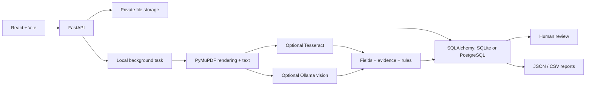

# System architecture

The frontend uses a same-origin `/api` proxy. Session cookies are HttpOnly and SameSite Strict. API resources are owner-scoped. No static public route serves private storage. Source-page requests also require authorization.

Default processing is OCR/text plus rules. Multimodal processing takes schema-validated fields from the local Ollama model, then executes the same rule engine. Hybrid processing supplements model fields missing by name with OCR-rule fields. This is a simple merge baseline, not learned fusion. Every processing run is stored independently as `analysis_run`; the document record carries its latest result.

Jobs run in the FastAPI process, so this version supports a single instance. SSE exposes stage changes; the frontend uses periodic workspace refresh while jobs run. Progress percentages are not synthesized.

Future architecture: separate durable workers, normalized domain tables, migrations, object storage, issuer connectors, shared-case RBAC, per-page evidence bounding boxes, versioned decision policies, and immutable run-level benchmark comparisons.
